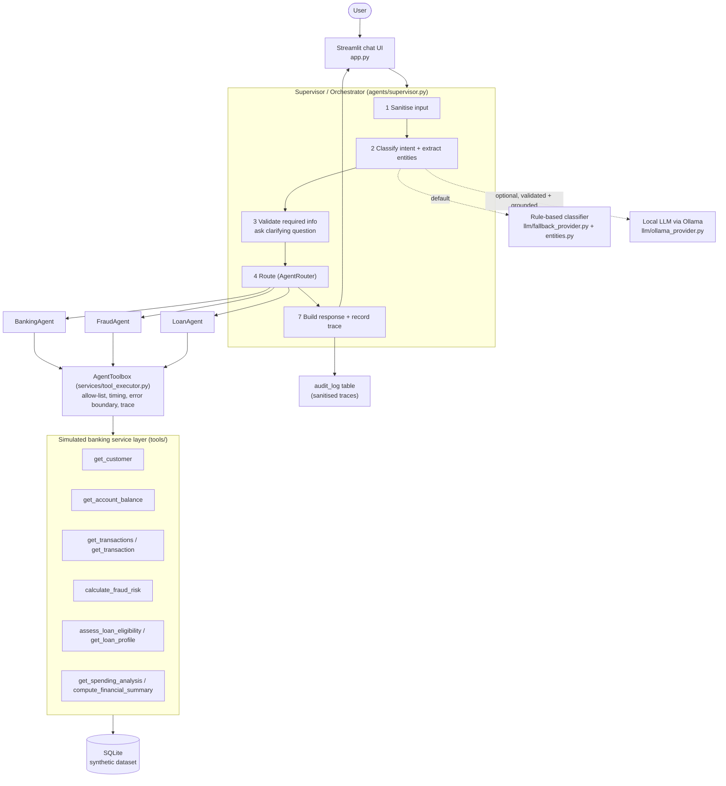
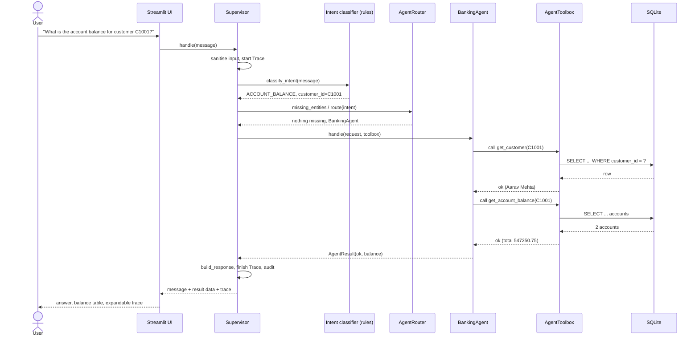
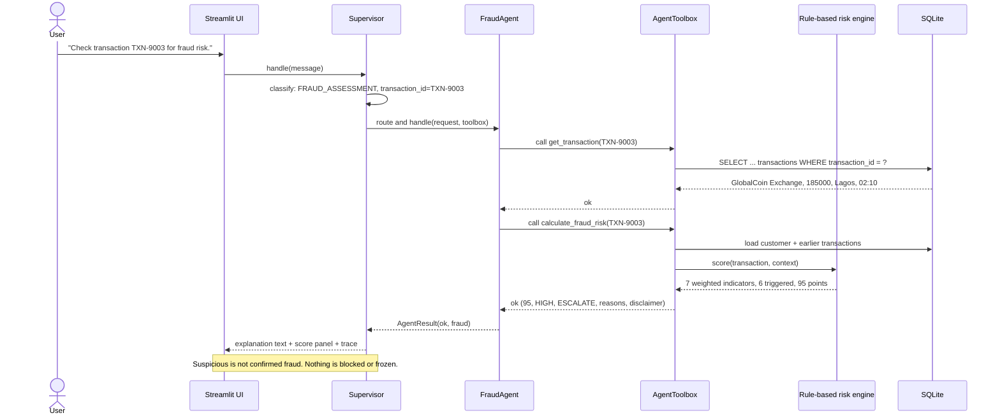

# AgentBank Architecture

AgentBank is a **simulation**. Every number below comes from synthetic data in a local SQLite file.

## 1. Component diagram

## 2. Components and responsibilities

| Module | Responsibility |
|---|---|
| `app.py` | Chat UI, example prompts, result panels, trace viewer, architecture and agent views. Contains no banking logic. |
| `agents/supervisor.py` | The orchestrator: sanitise → classify → validate → clarify → route → run agent → respond → trace. |
| `llm/fallback_provider.py`, `llm/entities.py` | Local rule-based intent classification and entity extraction. Separate from agent execution. |
| `llm/base.py` | Intent enum, `IntentResult` schema, validation and grounding of any LLM output, provider interface. |
| `llm/ollama_provider.py`, `llm/factory.py` | Optional local LLM; availability is verified before the app claims LLM mode. |
| `services/router.py` | Intent → agent table and the required-entity rules per intent. |
| `services/tool_executor.py` | `AgentToolbox`: the only way an agent reaches a tool. Per-agent allow-list, timing, exception containment, trace recording. |
| `agents/banking_agent.py` | Balance, history, spending analysis, composite financial summary. |
| `agents/fraud_agent.py` | Fetch the transaction, run the rule-based risk engine, return explainable result. |
| `agents/loan_agent.py` | Verify customer, run the threshold-based affordability assessment. |
| `tools/*.py` | Simulated internal banking APIs. Read-only, validated, parameterised SQL, structured results. |
| `services/response_builder.py` | Text built only from tool results. Optional LLM rephrasing is accepted only if every number is already in the tool data. |
| `services/audit_service.py` | `Trace` objects built by running code; sanitisation (redaction, truncation); `audit_log` persistence. |
| `database/`, `data/seed_data.py` | Schema and deterministic synthetic data. |

## 3. Request-processing sequence: balance inquiry

## 4. Request-processing sequence: fraud-risk assessment

## 5. Supervisor-to-agent routing

| Intent | Required information | Agent | Tool sequence (as recorded in the trace) |
|---|---|---|---|
| `ACCOUNT_BALANCE` | customer ID | BankingAgent | `get_customer` → `get_account_balance` |
| `TRANSACTION_HISTORY` | customer ID *or* transaction ID | BankingAgent | `get_customer` → `get_transactions` (or just `get_transaction`) |
| `SPENDING_ANALYSIS` | customer ID | BankingAgent | `get_customer` → `get_spending_analysis` |
| `CUSTOMER_FINANCIAL_SUMMARY` | customer ID | BankingAgent | `get_customer` → `get_account_balance` → `get_transactions` → `get_loan_profile` → `compute_financial_summary` |
| `FRAUD_ASSESSMENT` | transaction ID | FraudAgent | `get_transaction` → `calculate_fraud_risk` |
| `LOAN_ELIGIBILITY` | customer ID + loan amount | LoanAgent | `get_customer` → `assess_loan_eligibility` |
| `UNKNOWN` | none | none | no tools; lists supported operations, or explains the simulator is read-only for action requests |

If required information is missing the supervisor asks a question and calls no tool. If a message mentions two different customers or transactions it asks which one to use.

## 6. Tool invocation flow
1. An agent calls `toolbox.call("tool_name", **args)`.
2. The toolbox checks the registry and **that agent's allow-list**; a violation is blocked, returned as `TOOL_NOT_ALLOWED` and written to the trace.
3. It injects the database path and configuration, runs the function, times it and converts any exception into an error result (`TOOL_EXCEPTION`); a non-envelope return becomes `MALFORMED_TOOL_RESULT`.
4. The call (agent, tool, sanitised args, status, duration, sanitised result) is appended to the trace.
5. The tool itself validates IDs, limits, dates, months and amounts, uses parameterised SQL, and returns `{"ok": ...}` envelopes.

## 7. Data flow for the use cases
- **Balance:** message → `ACCOUNT_BALANCE` + `customer_id` → BankingAgent → customer row + accounts → total and per-account status.
- **History:** message → customer ID + limit (`five` → 5) → `get_transactions` newest first, optional status/date filters → table; empty history is a success with an explanatory message.
- **Fraud:** transaction row + the customer's earlier transactions (median debit, last-hour activity, usual cities) + home country → indicators → score → level → action.
- **Loan:** customer financial profile + amount → EMI → DTI before/after → four checks → decision, reasons, recommendations; NULL attributes → `INSUFFICIENT_DATA`.
- **Summary:** five sequential tool calls, then a pure aggregation. If one tool fails the summary is returned as `partial` and the missing part is named; nothing is invented.
- **Spending:** completed debits grouped by category for the requested (or latest) month.

## 8. Error-handling strategy
| Situation | Behaviour |
|---|---|
| Empty / non-string / over-long input | `empty` response, or truncated at 500 characters with a notice |
| Unknown intent | helpful list of supported operations; no tool is called |
| Action request (transfer, freeze, approve…) | refused as read-only; no tool is called |
| Missing identifier or amount | clarification question with an example |
| Unknown or malformed ID, invalid amount | `not_found` / `invalid_input` message from the tool's own error |
| Tool raises or returns garbage | contained by `AgentToolbox`; user sees a safe message; trace shows the failing tool; app keeps working |
| One tool fails inside the summary | `partial` result naming what is unavailable |
| Agent raises | caught by the supervisor, `error` status |
| LLM timeout / down / malformed / ungrounded | per-request fallback to rules; reason shown in notices and trace |
| Audit write fails | ignored; the request still succeeds |
| Anything unexpected in the UI | last-resort handler keeps the page usable |

## 9. Explanation of the rule-based "AI"
Intent classification and entity extraction are ordered regular expressions with explicit priorities. Fraud scoring is a weighted-rule table. Loan assessment is
an amortisation formula plus threshold checks. All three are **deterministic and explainable** and none is a trained model. Only the *optional* LLM mode involves a
neural model, and only for understanding the user's wording; its output is validated, and it never supplies banking facts.

| Concept | In this project |
|---|---|
| LLM-based reasoning | Optional: a local model turns free text into a structured intent. Output validated and grounded; can be wrong or unavailable. |
| Rule-based intent classification | Default: regex rules in `llm/fallback_provider.py`. Fast, free, predictable, narrow. |
| Machine-learning prediction | **Not implemented.** Would require labelled data, training, evaluation and model artifacts. |
| Deterministic banking tools | The source of truth for every number shown. |
| Multi-agent orchestration | Supervisor + router + specialised agents with separate tool permissions and a real trace. |

## 10. Why this is a multi-agent architecture
- Three agent classes with **separate responsibilities, inputs/outputs (`AgentRequest` → `AgentResult`) and separate tool permissions**.
- A **supervisor** that chooses the agent at run time from a validated intent, handles ambiguity and failures, and aggregates the result.
- Workflows with more than one step (financial summary) are coordinated tool sequences whose every step is recorded.
- The trace is produced by the code that executes; nothing is scripted after the fact. Tests assert blocked calls, tool order and failure containment.
- Honest scope: the agents are deterministic software components, not autonomous LLM agents. They do not plan or negotiate; the value is the architecture, isolation and observability.

## 11. Security boundaries
Untrusted: user text and (optional) LLM output. Trusted: tools and the database. Between them: input sanitiser → schema validation → grounding → required-entity check → allow-listed tools → parameterised SQL. The model cannot choose tools, write SQL or run code.

## 12. Differences from a production banking system
Real systems need authentication, authorisation (a customer must only see their own data), consent, encryption, real core-banking integration (APIs/message queues), tamper-evident audit trails,
rate limiting, monitoring, resilience, regulatory compliance (KYC/AML, data protection), model risk management and human-in-the-loop decisions for fraud and credit.
This project has none of those and does not claim production readiness.

## 13. Future evolution
- **Trained intent classifier:** collect labelled utterances per intent, split train/validation/test, train (e.g. TF-IDF + logistic regression or a small transformer), report accuracy/F1, keep the rules as a fallback and use the same `IntentResult` schema.
- **Fraud model:** label historical transactions, compute precision/recall of the current rules as a baseline, train a supervised model (e.g. gradient-boosted trees) behind the existing `RiskScorer` protocol, compare on a hold-out set, keep explanations (e.g. SHAP) and human review.
